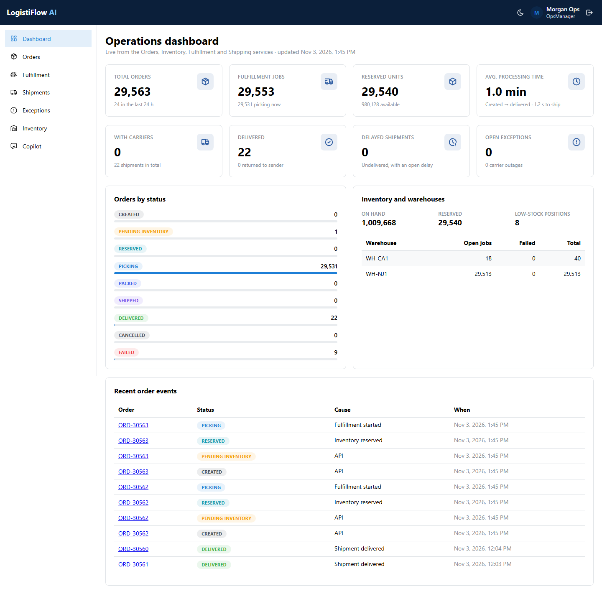
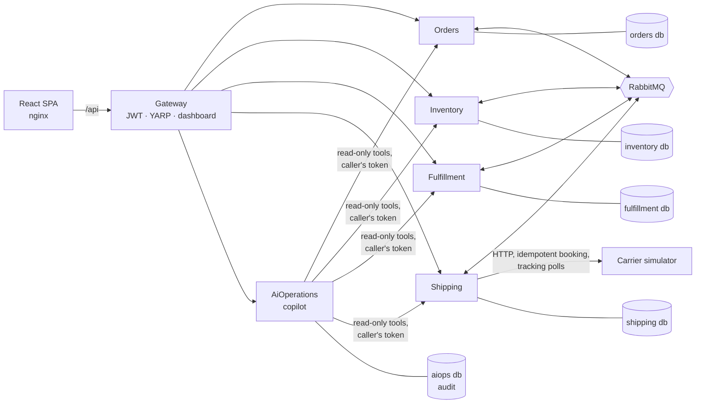

# LogistiFlow AI

**Cloud-native logistics and fulfillment platform** — a reference implementation of event-driven .NET microservices
for an e-commerce fulfillment operator: order intake, multi-warehouse inventory reservation, warehouse fulfillment,
carrier shipping with tracking and exceptions, an operations console, and an AI operations copilot that answers from
live platform data through read-only tools. An MCP server is built on top of this core in a later phase.

> Status: **Phases 1 to 4 complete** — an order runs from intake through reservation, pick, pack and ship to carrier
> delivery (or return) in Docker Compose, and an operations copilot explains it from live data, covered by unit,
> architecture, integration (Testcontainers) and Playwright tests, plus a k6 baseline for intake. See [STATUS.md](STATUS.md) for what is validated and what is planned.



## The business problem

Merchants send orders to a distribution network. Each order must be accepted exactly once, reserved against stock in
a single warehouse without overselling under concurrency, released to the warehouse floor, and tracked — while each
part of the system can be deployed, scaled and fail independently.

## Architecture



| Component | Responsibility |
|---|---|
| **Orders** | Idempotent order intake, order state machine, history timeline |
| **Inventory** | Products, warehouses, stock positions, all-or-nothing single-warehouse reservations, stock ledger |
| **Fulfillment** | One job per reserved order; pick, pack, ship, report issue and reprocess; execution history |
| **Shipping** | Shipments, carrier assignment, estimates, tracking, delays and operational exceptions |
| **AiOperations** | Operations copilot on Microsoft Agent Framework: nine read-only tools over the services, a deterministic demo provider (labelled as simulated) or an OpenAI-compatible model, audit of every question, tool call, token and cost |
| **Carrier simulator** | Stand-in for carrier APIs with deterministic scenarios (delay, 503, timeout, redelivery, return) |
| **Gateway** | Identity and JWT issuance, rate-limited login, YARP routing, resilient dashboard aggregation |
| **Web** | React + TypeScript console: dashboard, orders, fulfillment queue, shipments, exceptions, inventory, copilot |

More: [architecture overview](docs/architecture/overview.md) · [Phase 1 spec](docs/specifications/phase-1-order-to-fulfillment.md) ·
[Phase 2 spec](docs/specifications/phase-2-fulfillment-to-delivery.md) ·
[Phase 3 spec](docs/specifications/phase-3-processing-time-and-responsive.md) ·
[Phase 4 spec](docs/specifications/phase-4-ai-operations-copilot.md) · [ADRs](docs/decisions).

### Engineering highlights

- **Transactional outbox + idempotent inbox** on RabbitMQ: orders are accepted while the broker is down and delivered
  when it returns; redeliveries are applied once ([ADR-0003](docs/decisions/ADR-0003-rabbitmq-outbox-inbox.md)).
- **No overselling** with one conditional `UPDATE` per line — proven by 50 concurrent reservations for 10 units
  ([ADR-0005](docs/decisions/ADR-0005-inventory-concurrency.md)).
- **Out-of-order events** classified as applied, stale (ignored) or early (retried with backoff), then dead-lettered.
- **Idempotency-Key** on order intake, safe under concurrent duplicates (`INSERT … ON CONFLICT`).
- **Carrier calls outside message transactions:** a booking worker claims due shipments with `SKIP LOCKED`, retries
  with durable backoff and sends the shipment id as the carrier's idempotency key, so a timed-out booking is never
  made twice ([ADR-0006](docs/decisions/ADR-0006-shipping-and-carrier-integration.md)).
- **Delays and failures as data:** carrier delays, failed attempts, returns and outages open exceptions that delivery
  or an operator resolves, with KPIs on the dashboard.
- **Security by default:** every endpoint requires a token unless it opts out; permission policies per role; services
  re-validate the token the gateway issued ([ADR-0004](docs/decisions/ADR-0004-jwt-at-the-gateway.md)).
- **Architecture as tests:** 39 NetArchTest rules enforce service isolation (the carrier simulator shares no code),
  layer direction and folder conventions.

## Technology

.NET 10 · ASP.NET Core · Dapper · DbUp · PostgreSQL 17 · RabbitMQ 4.1 (`RabbitMQ.Client` 7) · YARP · FluentValidation ·
Serilog · OpenTelemetry · React 18 · TypeScript · Mantine · TanStack Query · xUnit v3 · NSubstitute · Testcontainers ·
NetArchTest · Playwright · k6 · Docker · GitHub Actions.

## Getting started

Requirements: Docker Desktop. For development also .NET SDK 10 and Node 24.

```bash
docker compose --profile app up -d --build --wait
```

- Console: http://localhost:8088 — sign in as `ops.manager@logistiflow.local` (or `admin@`, `warehouse.operator@`,
  `viewer@`) with the demo password `Demo-Password-2026!` (local only; override with `DEMO_PASSWORD` in `.env`).
- Gateway API: http://localhost:8089 · RabbitMQ management: http://localhost:15682
- Scripted end-to-end check: `powershell -File scripts/demo-flow.ps1`

Demo SKUs: `SKU-1001`…`SKU-1008` (stocked), `SKU-OOS-001` (no stock), `SKU-LIMITED-001` (10 units),
`SKU-BULK-001` (load tests).

Carrier sandbox: the destination city picks the simulated carrier behaviour. `Sandbox Delay`, `Sandbox Unavailable`
(two 503s), `Sandbox Timeout`, `Sandbox Redelivery` and `Sandbox Address Not Found` (returned to sender); any other
city is delivered normally. One tracking step every 3 s in compose (`CARRIER_STEP_INTERVAL`).

### Local development

```bash
docker compose up -d --wait postgres rabbitmq                              # infrastructure
dotnet run --project src/Services/Orders/LogistiFlow.Orders.Api -- --migrate   # same for Inventory (--seed-demo), Fulfillment, Shipping, Gateway (--seed-demo)
dotnet run --project src/Simulators/LogistiFlow.CarrierSimulator              # http://localhost:5190, used by Shipping
dotnet run --project src/Services/Orders/LogistiFlow.Orders.Api --launch-profile http
cd src/Web/logistiflow-web && npm ci && npm run dev                      # http://localhost:5173
```

## Testing

| Suite | Command | Count |
|---|---|---|
| Unit | `dotnet test --project tests/unit/<project>` | 221 |
| Architecture | `dotnet test --project tests/architecture/LogistiFlow.ArchitectureTests` | 39 |
| Integration (Docker required) | `dotnet test --project tests/integration/LogistiFlow.IntegrationTests` | 43 |
| E2E (stack running) | `cd tests/e2e && npm ci && npx playwright test` | 14 |
| Load | see [docs/performance](docs/performance/README.md) | baseline |

### Performance baseline (laptop, single instances)

Through the gateway, 10 VUs for 1 minute: **1,007 req/s, 0 % errors, p95 26.6 ms**; order intake **539 orders/s**
(p95 15.6 ms). End-to-end processing drained at **~154 orders/s**, limited by the sequential Orders consumer — the
measured bottleneck is documented in [the baseline report](docs/performance/baseline-2026-10-29.md). The baseline
predates Phase 2; shipping and carrier tracking have not been load tested yet.

## Roadmap

| Phase | Scope | Status |
|---|---|---|
| 0–1 | Foundation, Orders, Inventory, Fulfillment, Gateway, web console, tests, compose, CI | Done |
| 2 | Shipping service and deterministic carrier simulator, pick/pack/ship, tracking, exceptions, and the fulfillment, shipments and exceptions pages (moved up from Phase 3) | Done |
| 3 | "Average processing time" KPI, responsive checks for the new pages, demo flow to delivery (done); UI polish (not started) | Done, except UI polish |
| 4 | AI Operations Copilot (Microsoft Agent Framework, read-only tools, deterministic demo provider, audit and cost tracking); write actions with preview and confirmation are a later spec | Done |
| 5 | Custom MCP server and Claude Code skills | Planned |
| 6 | Observability stack, consumer concurrency, full k6 suite | Planned |
| 7 | Azure (Bicep: Container Apps, PostgreSQL Flexible, Key Vault), deployment pipeline | Planned |

## License

[MIT](LICENSE)
