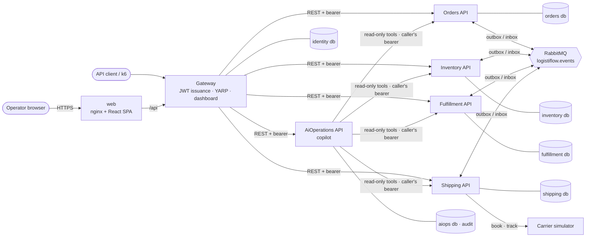
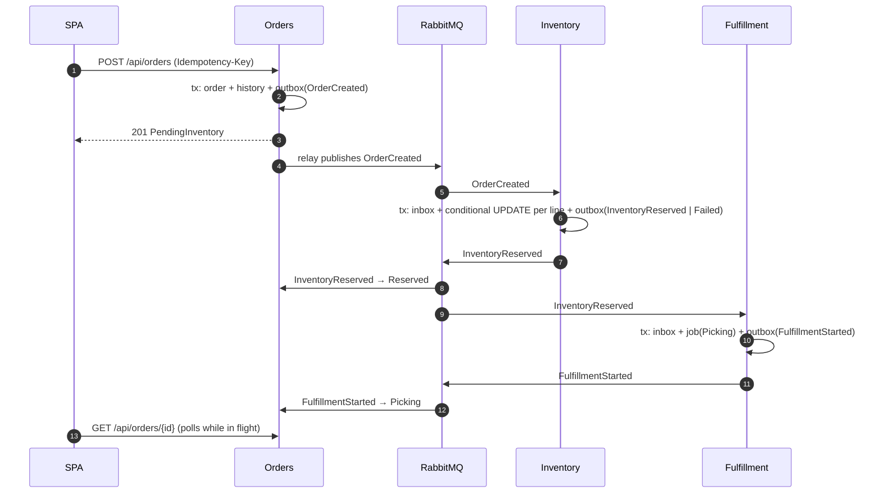
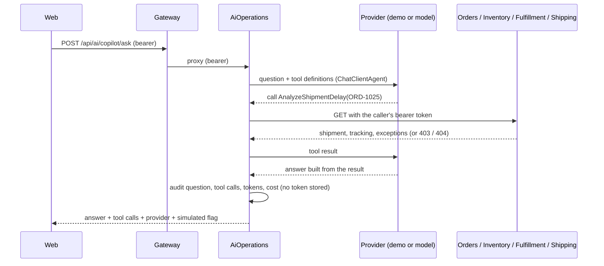

# Architecture overview



## First business flow



## Second flow: pack, ship, deliver

```mermaid
sequenceDiagram
    autonumber
    participant Op as Operator
    participant F as Fulfillment
    participant MQ as RabbitMQ
    participant O as Orders
    participant I as Inventory
    participant S as Shipping
    participant C as Carrier
    Op->>F: POST /jobs/{id}/pack → Packed + outbox(FulfillmentPacked)
    MQ->>O: FulfillmentPacked → Packed
    Op->>F: POST /jobs/{id}/ship → Shipped + outbox(FulfillmentShipped)
    MQ->>O: FulfillmentShipped → Shipped
    MQ->>I: FulfillmentShipped → consume reservation (on_hand and reserved drop)
    MQ->>S: FulfillmentShipped → shipment PendingBooking (no HTTP in this transaction)
    S->>C: booking worker: POST /v1/shipments (Idempotency-Key = shipment id)
    C-->>S: tracking number + estimate → LabelCreated
    loop tracking worker
        S->>C: GET /v1/shipments/{tracking}/events
        S->>S: store new events once; delays and failed attempts open exceptions
    end
    S->>MQ: ShipmentDelivered (or ShipmentReturned)
    MQ->>O: Delivered (or Failed: returned to sender)
```

## Copilot: how a question is answered



The services stay the only authority on what a user may read: a tool sees exactly what the caller could see through
the console. Without AI configuration the demo provider runs the same loop with fixed rules (ADR-0008).

## MCP server: how a client reads the platform

```
Claude Code (MCP client) ──stdio──▶ LogistiFlow.McpServer      (child process; stdout = protocol, logs on stderr)
                                     ├─ validates arguments     (ORD-…, SKU, enum filters, limit)
                                     ├─ token: LOGISTIFLOW_ACCESS_TOKEN, or sign-in with e-mail/password (cached)
                                     └─ GET through the gateway ─▶ Orders / Inventory / Fulfillment / Shipping
                                                                   (the user's role policies apply)
```

The server is a gateway client like the web console: it shares no code with the services
(`McpServer_ReferencesNoLogistiFlowAssembly`). Tool failures come back as MCP tool errors with a reason; results are
structured content that matches each tool's output schema. Decision record: ADR-0009.

## Integration events (v1)

| Event | Producer | Consumers | Effect |
|---|---|---|---|
| `orders.order-created` | Orders | Inventory, Shipping | Reserve stock; Shipping keeps the destination |
| `orders.order-cancelled` | Orders | Inventory, Fulfillment | Release stock (or tombstone), cancel job |
| `inventory.inventory-reserved` | Inventory | Orders, Fulfillment | Order → Reserved; start job |
| `inventory.inventory-reservation-failed` | Inventory | Orders | Order → Failed with shortages |
| `inventory.inventory-released` | Inventory | — | Audit (no consumer yet) |
| `fulfillment.fulfillment-started` | Fulfillment | Orders | Order → Picking |
| `fulfillment.fulfillment-packed` | Fulfillment | Orders | Order → Packed |
| `fulfillment.fulfillment-shipped` | Fulfillment | Orders, Inventory, Shipping | Order → Shipped; consume stock; open shipment |
| `shipping.shipment-delivered` | Shipping | Orders | Order → Delivered |
| `shipping.shipment-returned` | Shipping | Orders | Order → Failed (returned to sender) |

Every message carries `eventId`, `eventType`, `version`, `occurredAt`, `correlationId` and `causationId`, plus a
W3C `traceparent` header. Contracts: `src/Contracts/LogistiFlow.Contracts.IntegrationEvents`.

## Code layout (per service)

```
LogistiFlow.{Service}.Domain          Entities, Enums, Errors, Services (state machines), ReadModels, Interfaces/Repositories
LogistiFlow.{Service}.Application     UseCases/{Aggregate}/{Action}/{Contracts,Interfaces,Implementations,Validators}, IntegrationEventHandlers
LogistiFlow.{Service}.Infrastructure  Persistence/{Migrations,Queries,Rows,Repositories,Readers,Seed}
LogistiFlow.{Service}.Api             Controllers (+ Contracts), Program (composition root)
```

Rules are enforced by `tests/architecture` (service isolation, layer direction, folder conventions; the carrier
simulator and the MCP server may not reference any LogistiFlow assembly).
