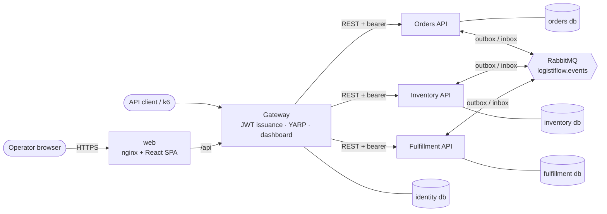
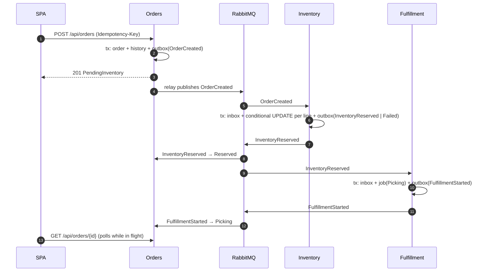

# Architecture overview



## First business flow



## Integration events (v1)

| Event | Producer | Consumers | Effect |
|---|---|---|---|
| `orders.order-created` | Orders | Inventory | Reserve stock |
| `orders.order-cancelled` | Orders | Inventory, Fulfillment | Release stock (or tombstone), cancel job |
| `inventory.inventory-reserved` | Inventory | Orders, Fulfillment | Order → Reserved; start job |
| `inventory.inventory-reservation-failed` | Inventory | Orders | Order → Failed with shortages |
| `inventory.inventory-released` | Inventory | — | Audit (no consumer yet) |
| `fulfillment.fulfillment-started` | Fulfillment | Orders | Order → Picking |

Every message carries `eventId`, `eventType`, `version`, `occurredAt`, `correlationId` and `causationId`, plus a
W3C `traceparent` header. Contracts: `src/Contracts/LogistiFlow.Contracts.IntegrationEvents`.

## Code layout (per service)

```
LogistiFlow.{Service}.Domain          Entities, Enums, Errors, Services (state machines), ReadModels, Interfaces/Repositories
LogistiFlow.{Service}.Application     UseCases/{Aggregate}/{Action}/{Contracts,Interfaces,Implementations,Validators}, IntegrationEventHandlers
LogistiFlow.{Service}.Infrastructure  Persistence/{Migrations,Queries,Rows,Repositories,Readers,Seed}
LogistiFlow.{Service}.Api             Controllers (+ Contracts), Program (composition root)
```

Rules are enforced by `tests/architecture` (29 rules: service isolation, layer direction, folder conventions).
